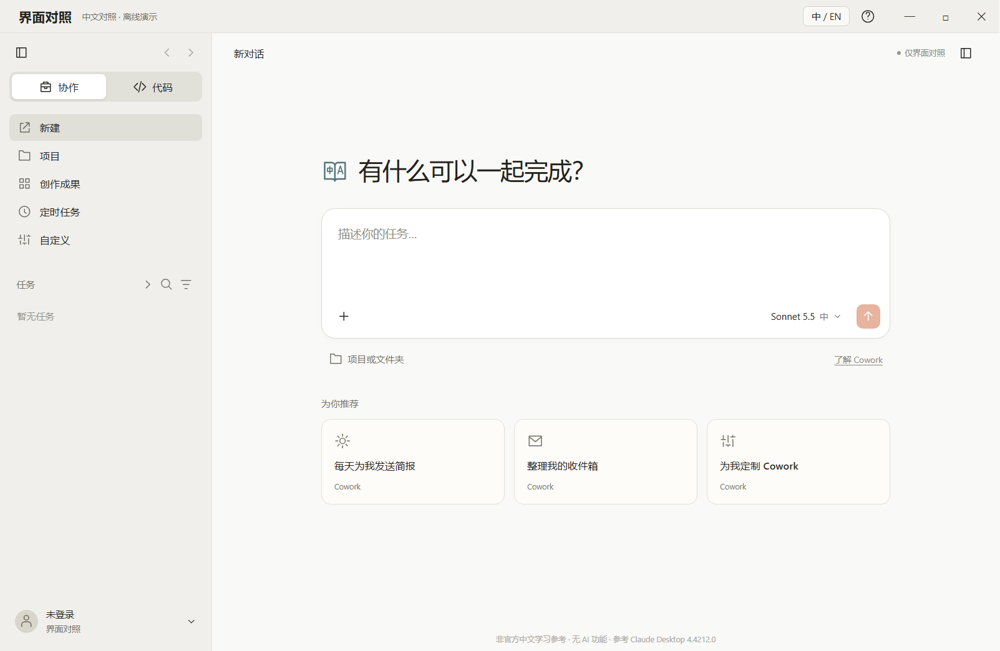

# 界面对照｜Claude 中文学习参考（非官方）

独立 Windows 桌面窗口，帮助理解 Claude Desktop 的英文按钮、菜单与设置。
**这是离线界面学习工具，无 AI 功能，与 Anthropic 无关联或背书关系。**
它不是官方中文版，不是汉化补丁，也不需要安装原版 Claude。

## 使用

从 Releases 获取便携版 ZIP，完整解压后双击 **Claude中文对照.exe**。
启动文件与 runtime 文件夹需放在一起，无需安装或登录。
支持 Windows 10/11 x64；本机验证环境为 Windows 10 Pro 19045。
程序未进行商业代码签名。

- 默认全中文、浅色主题、空白历史与账号状态。
- 悬停按钮、标题或设置说明，显示对应英文；英文模式下显示中文。
- 右上角「中 / EN」切换语言，或按 Ctrl + Shift + L。
- 覆盖 Cowork、Code、项目、创作成果、定时任务、菜单和 13 类设置页面。
- 左下角账号菜单进入设置；左上角「界面对照」打开菜单。
- 「？」包含说明和可搜索的中英文词条表。
- Esc 关闭菜单或弹窗；Ctrl + , 打开设置；Ctrl + K 搜索；Ctrl + B 切换侧栏。
- 输入和开关仅在内存中保留，退出后再次打开恢复空白中文界面。

## 演示边界

页面、菜单、分页、开关和输入框可交互。发送任务、选择文件、连接账号、安装插件、
重装工作区或删除数据等按钮只显示演示提示。

应用不调用 AI、不联网、不执行用户命令、不读取原版账号或配置、不操作用户选择的文件，
也不修改原版安装文件、签名、注册表或 Cowork 工作区。
程序需要读取自身文件；Electron 可能在系统临时目录创建内部缓存。
可与原版同时打开，逐项查看中文和英文。

本工具参考 Claude Desktop 4.4212.0 的部分结构与词条。部分页面为解释词义补充的示意，
并非完整逐像素复刻；原版账号差异、实验功能或更新可能改变实际界面。
模型名称仅作展示，不表示相关模型可用或已连接。

## 素材与许可

独立编写的代码、文档及自制双语书页图标采用 [MIT](LICENSE) 许可。
界面只引用系统字体，不附带字体文件或 Claude 的原版标识。
仓库不包含从原版提取的代码、CSS、字体、安装文件、账号配置或虚拟机镜像。
预览图来自本项目自身。

第三方产品名称、参考界面与权利边界见 [NOTICE.md](NOTICE.md)。
MIT 不授予第三方商标或原产品界面的权利。
Electron 等依赖按各自许可提供，见 [THIRD_PARTY_NOTICES.md](THIRD_PARTY_NOTICES.md)；
便携包保留 runtime/LICENSE 与 runtime/LICENSES.chromium.html。

## 开发

Windows 10/11 x64、Node.js 22 或更高版本，以及 Windows 自带的 .NET Framework C# 编译器。

    npm ci
    npm run audit:release
    npm test
    npm run build -- dist/portable
    npm test -- dist/portable/runtime/ClaudeReference.exe
    npm run audit:release -- dist/portable

测试使用 Electron 自带 Chromium，无需另装 Playwright 浏览器。
npm ci 首次安装需要从官方源下载依赖和 Electron 运行时。
如果运行时下载失败，下载官方对应版本 ZIP，核对 Electron 包中的 checksums.json，
解压到 node_modules/electron/dist，并将 node_modules/electron/path.txt 写为 electron.exe。

npm run pack:source -- dist/source 按固定清单生成干净源码目录。
构建脚本不会覆盖已有的非空输出目录。
GitHub Actions 配置仅运行检查，不自动发布成品。

## 发布

仓库建议名：claude-ui-zh-reference。
源码提交到仓库，便携 ZIP 作为 Release 附件。操作与发布说明模板见 [PUBLISHING.md](PUBLISHING.md)。
请使用 1.1.0 或更新的公开准备版，勿重新分发此前含提取字体的个人使用版。
